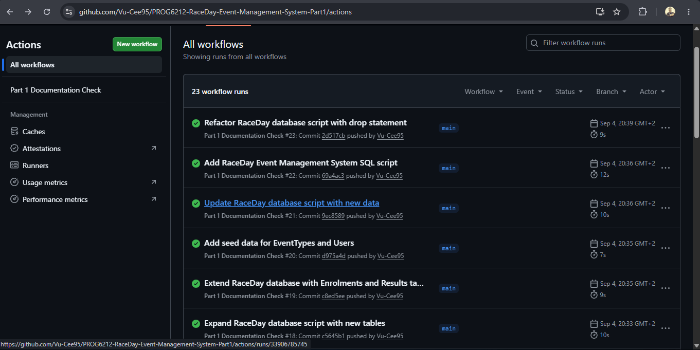
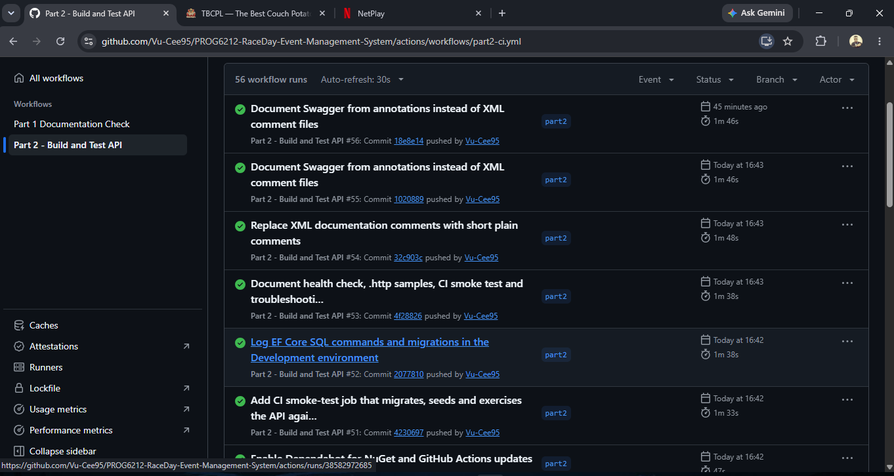

# RaceDay Event Management System

**Module:** PROG6212 - Programming 2B | **Assessment:** Portfolio of Evidence (Parts 1-3)
**Student:** VuCee95 | **Repository:** https://github.com/Vu-Cee95/PROG6212-RaceDay-Event-Management-System-Part1

## Project Description

RaceDay is a full-stack web-based event management system designed for the South African road running,
walking and cycling community. Organisers create and manage events, define age or distance categories,
view enrolments and capture race results. Participants browse events, enter an event by selecting a
category, and track their enrolments and personal race history.

The system is built progressively across three parts:

| Part | Deliverable | Status |
|------|-------------|--------|
| 1 | System planning: ERD, API endpoint plan, SQL database script | Complete - see [Part 1](#part-1---system-planning-and-database) |
| 2 | RESTful API (ASP.NET Core Web API, EF Core Code-First, session auth, Swagger, unit tests, CI/CD) | Complete - see [Part 2](#part-2---restful-api-development) |
| 3 | MVC web application, Azure Blob Storage, Docker | Not started |

## User Roles

The system supports two distinct roles. Role-based access is enforced on the API in Part 2 and will be
reflected in the MVC interface in Part 3.

### Organiser
- Create, edit and delete **their own** events (name, description, date, location, distance, event type).
- Define age or distance categories for their events (e.g. Under 20, Senior, 10km, 21km).
- View all enrolments for their events and confirm or cancel them.
- Capture finish times and finishing positions for Participants after an event.
- View and update their own profile.

### Participant
- Register an account and log in.
- Browse all events and the categories available for each event.
- Enter an event by selecting a category (one entry per event).
- View their own enrolments and their status (Pending / Confirmed / Cancelled).
- View their own race results (finish time, finishing position, total finishers).
- View and update their own profile.

## Repository Structure

```
RaceDay
|-- docs/                                Part 1 planning documents (unchanged)
|   |-- RaceDay_ERD.pdf
|   |-- RaceDay_API_Endpoint_Plan.pdf
|   |-- RaceDay_Database.sql
|   `-- screenshots/                     CI/CD green-build screenshots
|-- RaceDay.Api/                         Part 2 - ASP.NET Core Web API
|   |-- Controllers/                     One controller per resource
|   |-- Data/                            RaceDayDbContext, DbSeeder, EF Core Migrations
|   |-- Filters/                         RequireAuthenticated / RequireRole session filters
|   |-- Models/                          Entity classes (one per ERD entity)
|   |-- Services/                        Business logic (Auth, Profile, Event, Category, Enrolment, Result)
|   |-- appsettings.json                 SQL Server connection string
|   |-- RaceDay.Api.http                 Ready-to-send sample requests (Visual Studio / VS Code REST Client)
|   `-- Program.cs                       DI, session, Swagger, error handling, migrate + seed on startup
|-- RaceDay.Contracts/                   Shared DTOs (used by the API now and by the MVC app in Part 3)
|   `-- Dtos.cs
|-- RaceDay.Api.Tests/                   xUnit test project (144 tests)
|-- RaceDay.sln
|-- .editorconfig                        Shared C# formatting rules
|-- .github/
|   |-- dependabot.yml                   Weekly NuGet / monthly Actions update PRs
|   `-- workflows/
|       |-- part1-ci.yml                 Part 1 - validates the docs folder
|       `-- part2-ci.yml                 Part 2 - build, test, validate structure, smoke-test against SQL Server
`-- README.md
```

---

## Part 1 - System Planning and Database

### Deliverables
- **ERD:** [`docs/RaceDay_ERD.pdf`](docs/RaceDay_ERD.pdf) - six entities (Users, EventTypes, Events, Categories,
  Enrolments, Results) with primary keys, foreign keys and cardinality.
- **API Endpoint Plan:** [`docs/RaceDay_API_Endpoint_Plan.pdf`](docs/RaceDay_API_Endpoint_Plan.pdf) - every
  endpoint with HTTP method, route, description, role, request body and expected responses.
- **SQL Database Script:** [`docs/RaceDay_Database.sql`](docs/RaceDay_Database.sql) - creates the `RaceDay`
  database, all tables and constraints, and seeds realistic sample data.

### Running the SQL script
1. Install SQL Server (Express or Developer) and SQL Server Management Studio (SSMS).
2. Open `docs/RaceDay_Database.sql` in SSMS.
3. Execute the script (F5). It creates the `RaceDay` database, all tables, constraints and seed data
   (2 Organisers, 2 Participants, 3 Events, 6 Categories, 4 Enrolments, 2 Results).

### Part 1 CI/CD
The workflow `.github/workflows/part1-ci.yml` runs on every push and pull request and validates that the
`/docs` folder exists and contains the ERD, endpoint plan, SQL script and README.



### Part 1 Video
YouTube (unlisted): https://youtu.be/xDh7BlfpNdU

### Technologies used in Part 1
SQL Server Management Studio (database design and scripting), Draw.io (ERD), GitHub Actions (CI validation), Markdown.

---

## Part 2 - RESTful API Development

Part 2 implements the API planned in Part 1. The Part 1 ERD, endpoint plan and SQL script were used as the
specification; see [Deviations and additions](#deviations-and-additions-to-the-part-1-plan) for the few places
where the implementation extends the plan.

### Technologies Used
| Technology | Purpose |
|------------|---------|
| .NET 10 / ASP.NET Core Web API (C#) | API framework |
| Entity Framework Core 10 (Code-First) + SQL Server | Data access; migrations generate the schema |
| ASP.NET Core Session (`Microsoft.AspNetCore.Session`) | Server-side session storing `UserId` and `Role` |
| ASP.NET Core Identity `PasswordHasher<T>` | PBKDF2 password hashing with per-user salt |
| Swashbuckle.AspNetCore + Annotations | Swagger / OpenAPI documentation and UI |
| xUnit, `Microsoft.AspNetCore.Mvc.Testing`, EF Core InMemory | Automated tests |
| GitHub Actions | CI/CD - build, test and structure validation on every push |

### Project Structure
The solution has three projects:

| Project | Type | Purpose |
|---------|------|---------|
| `RaceDay.Api` | ASP.NET Core Web API | Controllers, services, filters, models, DbContext, migrations |
| `RaceDay.Contracts` | Class library | Request/response DTOs shared with the Part 3 MVC client |
| `RaceDay.Api.Tests` | xUnit | Integration tests (real API hosted in memory) and unit tests |

Controllers are thin: each action calls a service that returns a `ServiceResult<T>` carrying the HTTP status
code and payload or error. Business rules (ownership, duplicates, validation) live in `RaceDay.Api/Services`.

### Prerequisites
- [.NET 10 SDK](https://dotnet.microsoft.com/download/dotnet/10.0)
- SQL Server (Express, Developer or LocalDB) and optionally SSMS
- Visual Studio 2022 17.12+ / Visual Studio 2026, or the `dotnet` CLI
- (Optional) `dotnet-ef` tool for working with migrations: `dotnet tool install --global dotnet-ef`

### Database Setup (EF Core Code-First)

The database is generated from the C# models and `RaceDayDbContext` using migrations. The generated schema
reproduces the Part 1 SQL script table for table: same table and column names, data types
(`datetime`, `decimal(5,2)`, `time(0)`, `nvarchar` lengths), `NOT NULL`, `UNIQUE` (Email, TypeName,
Results.EnrolmentId), `DEFAULT GETDATE()`, the `CHECK (Role IN ('Organiser','Participant'))` constraint and
`NO ACTION` on every foreign key.

1. Open `RaceDay.Api/appsettings.json` and adjust the connection string for your SQL Server instance if needed:
   ```json
   "DefaultConnection": "Server=localhost;Database=RaceDayDb;Trusted_Connection=True;TrustServerCertificate=True;MultipleActiveResultSets=True;"
   ```
   Use `Server=.\\SQLEXPRESS` for SQL Server Express or `Server=(localdb)\\MSSQLLocalDB` for LocalDB.
2. Apply the migration (either option):
   - **Visual Studio** - Package Manager Console, default project `RaceDay.Api`: `Update-Database`
   - **CLI** - from the repository root: `dotnet ef database update --project RaceDay.Api`
   - **Automatic** - the API also runs `Database.Migrate()` on startup, so simply running the API creates the database.
3. Verify in SSMS that `RaceDayDb` contains `Users`, `EventTypes`, `Events`, `Categories`, `Enrolments`,
   `Results` and `__EFMigrationsHistory`.

The database name is `RaceDayDb` (not `RaceDay`) so the Part 1 script and the Code-First database can exist
side by side on the same server for comparison.

#### Seed data
On first start the API seeds the same sample data as the Part 1 script, but with **hashed** passwords.
All seeded accounts use the password `Password123!`.

| Email | Role | Name |
|-------|------|------|
| thabo.mokoena@raceday.co.za | Organiser | Thabo Mokoena (owns Soweto Marathon, Cape Town Cycle Tour) |
| sarah.vandermerwe@raceday.co.za | Organiser | Sarah van der Merwe (owns Durban Park Run) |
| lwando.dlamini@gmail.com | Participant | Lwando Dlamini (2 enrolments, 2 results) |
| priya.naidoo@gmail.com | Participant | Priya Naidoo (2 enrolments) |

### How to Run the API
```bash
git clone https://github.com/Vu-Cee95/PROG6212-RaceDay-Event-Management-System-Part1.git
cd PROG6212-RaceDay-Event-Management-System-Part1
dotnet restore RaceDay.sln
dotnet run --project RaceDay.Api
```
Or open `RaceDay.sln` in Visual Studio, set `RaceDay.Api` as the startup project and press F5.

The API listens on `https://localhost:7166` and `http://localhost:5261` and opens **Swagger UI** at
`https://localhost:7166/swagger`. On the first run it creates and seeds the database.

A health check is at `/health`. You can also open `RaceDay.Api/RaceDay.Api.http` in Visual Studio
and click **Send Request** on any sample (login first so the session cookie is kept).

### Authentication and Role-Based Access

**Registration** (`POST /api/auth/register`) - the user supplies email, password, full name and a role of
`Organiser` or `Participant`. The API validates the role, rejects duplicate emails, hashes the password with
`PasswordHasher<T>` (PBKDF2-HMAC-SHA512, 100 000 iterations, random salt) and stores only the hash in
`Users.PasswordHash`. The plain-text password is never persisted.

**Login** (`POST /api/auth/login`) - the API looks the user up by email and verifies the password against the
stored hash. On success it writes `UserId` and `Role` into the **server-side session** and returns a
`.RaceDay.Session` cookie. The browser (and Swagger UI) sends this cookie automatically on every later request,
so the API always knows who is calling and what role they hold. Unknown email and wrong password both return
`401` with the same message so attackers cannot tell which one was wrong.

**Logout** (`POST /api/auth/logout`) clears the session; protected endpoints return `401` again afterwards.

**Role enforcement** is implemented with two action filters in `RaceDay.Api/Filters`:
- `[RequireAuthenticated]` - 401 Unauthorized when there is no logged-in session (used for the profile endpoints that both roles share).
- `[RequireRole("Organiser")]` / `[RequireRole("Participant")]` - 401 when anonymous, **403 Forbidden** when the
  logged-in user has the other role.

In addition, services enforce **ownership**: an Organiser can only update/delete their own events, manage
categories, enrolments and results of their own events, and a Participant can only read their own enrolments
and results (`403` otherwise). Public endpoints (browse events, categories and event types) need no login.

| Status | Meaning in RaceDay |
|--------|--------------------|
| 200 OK / 201 Created / 204 No Content | Success |
| 400 Bad Request | Validation failed, invalid role/status, duplicate email, category not in event |
| 401 Unauthorized | Not logged in, or wrong credentials |
| 403 Forbidden | Logged in but wrong role, or not the owner of the resource |
| 404 Not Found | Event / category / enrolment does not exist |
| 409 Conflict | Already enrolled, result already captured, deleting an event/category that has enrolments |

### API Endpoints

All routes from the Part 1 endpoint plan are implemented with the same method, route, role, request body and
response codes. Roles: **None** = public, **Any** = any logged-in user.

| Method | Route | Description | Role | Request body | Responses |
|--------|-------|-------------|------|--------------|-----------|
| POST | `/api/auth/register` | Register a new Organiser or Participant | None | `{ email, password, fullName, role }` | 201, 400 |
| POST | `/api/auth/login` | Log in and start a session | None | `{ email, password }` | 200, 400, 401 |
| GET | `/health` | Liveness probe *(addition)* | None | - | 200 |
| POST | `/api/auth/logout` | End the session *(addition)* | None | - | 204 |
| GET | `/api/users/profile` | Get the logged-in user's profile | Any | - | 200, 401 |
| PUT | `/api/users/profile` | Update own name / profile picture URL | Any | `{ fullName, profilePictureUrl }` | 200, 400, 401 |
| GET | `/api/eventtypes` | List event types (Run, Walk, Cycle) *(addition)* | None | - | 200 |
| GET | `/api/events` | List all events | None | - | 200 |
| GET | `/api/events/mine` | List the Organiser's own events *(addition)* | Organiser | - | 200, 401, 403 |
| GET | `/api/events/{eventId}` | Event details | None | - | 200, 404 |
| POST | `/api/events` | Create an event | Organiser | `{ name, description, eventDate, location, distance, eventTypeId }` | 201, 400, 401, 403 |
| PUT | `/api/events/{eventId}` | Update own event | Organiser | same as create | 200, 400, 401, 403, 404 |
| DELETE | `/api/events/{eventId}` | Delete own event | Organiser | - | 204, 401, 403, 404, 409 |
| GET | `/api/events/{eventId}/categories` | List categories of an event | None | - | 200, 404 |
| POST | `/api/events/{eventId}/categories` | Add a category to own event | Organiser | `{ categoryName, description }` | 201, 400, 401, 403, 404 |
| PUT | `/api/categories/{categoryId}` | Update a category | Organiser | `{ categoryName, description }` | 200, 400, 401, 403, 404 |
| DELETE | `/api/categories/{categoryId}` | Delete a category | Organiser | - | 204, 401, 403, 404, 409 |
| POST | `/api/enrolments` | Enter an event in a category | Participant | `{ eventId, categoryId }` | 201, 400, 401, 403, 409 |
| GET | `/api/users/{userId}/enrolments` | Participant's own enrolments | Participant | - | 200, 401, 403 |
| GET | `/api/events/{eventId}/enrolments` | All enrolments for own event | Organiser | - | 200, 401, 403, 404 |
| PUT | `/api/enrolments/{enrolmentId}/status` | Confirm / cancel an enrolment *(addition)* | Organiser | `{ status }` | 200, 400, 401, 403, 404 |
| POST | `/api/enrolments/{enrolmentId}/result` | Capture finish time and position | Organiser | `{ finishTime, finishingPosition, notes }` | 201, 400, 401, 403, 404, 409 |
| GET | `/api/users/{userId}/results` | Participant's own results and history | Participant | - | 200, 401, 403 |
| GET | `/api/events/{eventId}/results` | All results for own event *(addition)* | Organiser | - | 200, 401, 403, 404 |

#### Deviations and additions to the Part 1 plan
All 18 planned endpoints are implemented exactly as planned. The following were **added** (none of the planned
routes changed):

| Addition | Reason |
|----------|--------|
| `GET /health` | Simple up/down check used by CI and anyone hosting the API. |
| `POST /api/auth/logout` | The brief requires users to be able to end their session; the plan only listed register and login. |
| `GET /api/eventtypes` | The planned event body uses `eventTypeId`; clients need a lookup to know the valid ids. |
| `GET /api/events/mine` | Lets an Organiser list only their own events (needed for the Part 3 dashboard). |
| `PUT /api/enrolments/{enrolmentId}/status` | Enrolments have a `Status` column (Pending/Confirmed/Cancelled) in the ERD; the Organiser needs a way to change it. |
| `GET /api/events/{eventId}/results` | Lets an Organiser review all results captured for an event (Part 3 results page). |
| `409 Conflict` on `DELETE /api/events/{eventId}` and `DELETE /api/categories/{categoryId}` | Foreign keys use `NO ACTION` (as in the SQL script), so an event or category with enrolments cannot be deleted; a clear 409 is returned instead of a database error. |

Schema notes: where the ERD and SQL script used slightly different names or lengths (ERD `ProfilePicture` vs
script `ProfilePictureUrl`, ERD `FinishPosition` vs script `FinishingPosition`, ERD `ResultsID` vs script
`ResultId`, ERD `Location NVARCHAR(100)` vs script `NVARCHAR(200)`), the Code-First model follows the **SQL
script**, because it is the executable version of the design.

### Swagger
Swagger UI is available at `/swagger` in every environment (`https://localhost:7166/swagger`). Every endpoint
shows a summary, a description of who may call it and what it expects, the request schema and all possible
response codes with their payload types. Endpoints are grouped by resource: Auth, User Profile, Event Types,
Events, Categories, Enrolments, Results.

Because authentication uses a session cookie, protected endpoints can be tested in Swagger with no extra
tooling - log in once and the cookie is sent automatically. Suggested walkthrough:

1. `POST /api/auth/login` as `thabo.mokoena@raceday.co.za` / `Password123!` (Organiser).
2. `POST /api/events` - create an event; `POST /api/events/{eventId}/categories` - add a category.
3. `POST /api/enrolments` - returns **403** because an Organiser cannot enrol.
4. `POST /api/auth/logout`, then `POST /api/auth/register` + `POST /api/auth/login` as a new Participant.
5. `POST /api/enrolments` with the new event and category - **201**; `GET /api/users/{yourUserId}/enrolments`.
6. `POST /api/events` - returns **403** because a Participant cannot create events.
7. Log back in as the Organiser: `GET /api/events/{eventId}/enrolments`, then
   `POST /api/enrolments/{enrolmentId}/result` with `{ "finishTime": "01:42:17", "finishingPosition": 1 }`.
8. Log in as the Participant again: `GET /api/users/{yourUserId}/results`.

### Unit Testing
The `RaceDay.Api.Tests` project contains **144 tests** (xUnit). Integration tests host the real API with
`WebApplicationFactory<Program>`, replacing SQL Server with an isolated EF Core InMemory database seeded with the
same sample data, so controllers, filters, session handling and services are exercised end to end. Pure unit
tests cover the password service and the authorisation filters.

Run them with `dotnet test RaceDay.sln` or from Visual Studio **Test > Test Explorer**.

| Test class | What it proves |
|------------|----------------|
| `AuthenticationTests` | Registration for both roles; duplicate email, invalid role and validation failures (400); password stored as a hash; login success, wrong password and unknown email (401); session cookie issued and isolated per client; logout clears the session. |
| `PasswordServiceTests` | Hashes never contain the password, are salted (different each time) and verify correctly; wrong or corrupt input fails. |
| `RoleFilterTests` | `RequireAuthenticated` / `RequireRole` return 401 for anonymous users, 403 for the wrong role and pass the correct role. |
| `RoleBasedAccessTests` | Every protected endpoint returns 401 without login; every Organiser-only endpoint returns 403 to a Participant; every Participant-only endpoint returns 403 to an Organiser; public endpoints stay open; profile is available to both roles. |
| `ProfileTests` | Both roles read and update only their own profile; validation; one user's update does not affect another. |
| `EventManagementTests` | Organisers create, update and delete their own events (fields verified in the database); other organisers and participants are rejected; unknown ids return 404; events with enrolments return 409; `events/mine` is scoped to the caller. |
| `CategoryTests` | Category CRUD restricted to the owning organiser; public listing; duplicate names and categories with enrolments are rejected. |
| `EnrolmentTests` | Participants enrol and the Participant-Event-Category link is recorded correctly; duplicate (409), wrong category (400), wrong role (403), anonymous (401); own-only listing; organiser view and status management scoped to own events. |
| `ResultTests` | Organisers capture results for their own events (one per enrolment, validation, 403 for others); participants view only their own history with finish time and position; event results ordered by position. |
| `ApiBehaviourTests` | `/health` returns Healthy; unknown routes return 404; bad JSON and validation errors use the same `ApiError` shape; the Swagger document lists every tag. |

### CI/CD
`.github/workflows/part2-ci.yml` runs on every push and pull request:

1. Checkout and install the .NET 10 SDK
2. `dotnet restore` / `dotnet build --configuration Release`
3. `dotnet test` (results uploaded as a TRX artifact)
4. Validate the repository structure (Part 1 docs and the Part 2 solution layout)
5. Start a SQL Server container, run the API (migrate + seed), then hit `/health`, Swagger, public events, a 401 on a protected route, and a real Organiser login

The Part 1 workflow (`part1-ci.yml`) continues to run alongside it. `.github/dependabot.yml` opens weekly NuGet / monthly Actions update pull requests so those builds stay green.

### Troubleshooting
- **SQL Server is not running:** start the default instance (`localhost`). The API creates `RaceDayDb` on first run.
- **"file is locked by RaceDay.Api":** stop the running API (Ctrl+C or Shift+F5) before you build or test.
- **Wrong database:** Part 1's SQL script uses `RaceDay`. The API uses `RaceDayDb` in `appsettings.json`.
- **HTTPS certificate warning:** use the HTTP profile (`http://localhost:5261/swagger`) or trust the ASP.NET HTTPS cert.

### GitHub Actions Screenshot


### Part 2 Video Presentation
YouTube (unlisted): _link to be added after recording_
